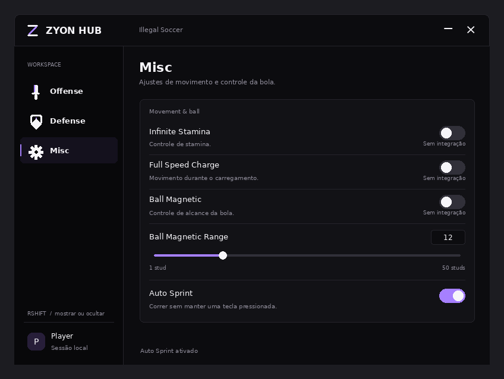

# Zyon Hub

[Análise do loader enviado e mapa dos módulos de Illegal Soccer](docs/analise-illegal-soccer.md).

Interface refeita do zero para a source de **Illegal Soccer** fornecida pelo autor.
Tema preto fosco e roxo suave, texto branco, abas laterais, linhas compactas,
bordas discretas, ícones vetoriais e feedback de hover. Janela arrastável,
botões de minimizar/descarregar e suporte a mouse e toque.



Prévia local gerada a partir da árvore da interface com mocks. Não é uma captura
do Roblox; o estado de Auto Sprint nesta imagem é simulado.

## Arquivos

- `zyon-hub.lua`: script completo, com o núcleo original e a nova interface embutida.
- `zyon-ui-preview.lua`: prévia independente da interface. Pode ser colocada em um
  **LocalScript** em `StarterPlayer > StarterPlayerScripts` no Roblox Studio. Não
  carrega módulos do jogo nem executa automações. Os controles de gameplay ficam
  sinalizados como sem integração; clicar explica o motivo. Navegação, slider,
  entrada numérica de alcance e janela podem ser experimentados.
- `src/ZyonUI.luau`: implementação da interface, sem biblioteca externa.
- `src/AutoSprint.luau`: controlador de entrada para usar a tecla de Sprint do jogo
  enquanto o personagem se move; pausa ao digitar, perder foco ou abrir menus.
- `src/zyon-core.luau`: núcleo e integração dos controles. O núcleo continua
  dependendo dos módulos específicos de Illegal Soccer presentes na source enviada.

**RightShift** mostra ou oculta a janela. Arraste pelo cabeçalho para mover.
O botão **×** do script completo chama o descarregamento da source.

## Abas e estado das funções

| Aba | Controles | Integração |
| --- | --- | --- |
| Offense · faca | Auto Shooting | Usa a assistência de mira e liberação da source. O jogador ainda inicia o chute. |
| Offense · faca | Auto Passing | Pendente: não havia implementação na source. |
| Defense · escudo | Auto GK; Close-range Rush; High-ball Jumps; Jump Then Dive; Lob / Back Recovery | Ligados aos controles originais do goleiro. Auto GK inicia desligado. |
| Defense · escudo | Dive Direction; Position Assist; Pre-shot Coverage; Position Mode; Manual Movement First | Ligados às configurações originais, preservando as reinicializações do planejador. |
| Defense · escudo | Status; contadores de solicitações/saltos/mergulhos/rush; diagnóstico | Lê o estado original e permite imprimir `AutoGKDebug()` no console. |
| Misc · engrenagem | Infinite Stamina; Full Speed Charge; Ball Magnetic | Ainda sem implementação na source. A linha inteira e o switch respondem ao clique e explicam a ausência da integração. |
| Misc · engrenagem | Auto Sprint | Usa o binding `Sprint` do jogo com entrada virtual. Depende de o executor permitir `VirtualInputManager.SendKeyEvent`. Respeita as regras normais de velocidade e stamina. Falhas aparecem na linha da opção. |
| Misc · engrenagem | Ball Magnetic Range | Slider e campo numérico de 1 a 50 studs, padrão 12. Guarda a seleção da sessão; só afetará a bola quando Ball Magnetic for implementado. |

Controles sem implementação permanecem desligados, mas aceitam clique para
explicar a limitação. Todas as linhas de Misc cabem na área padrão em desktop.
O Auto Sprint solta a tecla ao parar, perder foco ou descarregar; se o executor
recusar uma operação, o erro é mostrado e a liberação pode ser tentada novamente.
Os testes locais **não validam**
o comportamento dentro de Illegal Soccer: Roblox e os módulos do jogo não estão
disponíveis nesta máquina.

## Desenvolvimento e testes

Edite os arquivos de `src/` e gere novamente os dois scripts:

```sh
python3 tools/build.py
```

Os testes usam o CLI oficial de Luau e mocks de Roblox para executar os callbacks
reais da interface. Também verificam os adaptadores extraídos do núcleo e compilam
os scripts completos. Com `luau` e `luau-compile` no PATH:

```sh
python3 tools/test.py
```

Alternativamente, defina `LUAU_BIN=/caminho/para/luau`. Validação nesta tarefa:
Luau 0.727, **23 testes de interface, 7 de Auto Sprint e 6 verificações de integração**.

Para conectar uma função nova, forneça um adaptador na tabela `features` da
integração do núcleo. O método `Set` deve executar a alteração real e devolver
`false` se ela falhar. `Get` deve consultar o estado real como um booleano.
Também é possível registrar um adaptador durante a sessão com
`ZyonHub.BindFeature(chave, { Get = getter, Set = setter })` no mesmo ambiente
global da source. As chaves ainda sem implementação são `autoPassing`,
`infiniteStamina`, `fullSpeedCharge` e `ballMagnetic`.

`ZyonHub.GetState().magneticRange` expõe o valor escolhido no slider. Um módulo
que precise reagir imediatamente ao slider pode usar o callback `onRangeChanged`
da interface. As seleções das novas opções ficam apenas na sessão; os arquivos
de configuração antigos não são importados automaticamente.
