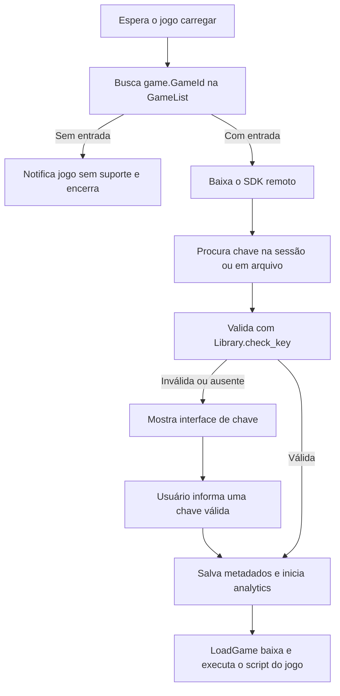

# Análise do material de Illegal Soccer

Data: 23/10/2026. Objetivo: identificar o que o arquivo enviado revela, o que a
source anterior já referencia e o que falta para integrar as funções do Zyon Hub.

## Resultado principal

O novo arquivo é um **loader do Sportsclub com sistema de licença e interface de
chave**. O código específico de cada jogo é baixado posteriormente. Este anexo
não contém as implementações de gameplay de Illegal Soccer nem o código-fonte
completo do próprio jogo.

A análise encontrou **78 entradas de jogos** no loader e **49 caminhos distintos
de módulos** referenciados pela source que já usamos no Zyon Hub. Esses caminhos
são expectativas da source anterior; sua existência e suas assinaturas na versão
atual do jogo ainda precisam ser verificadas no cliente Roblox.

## Material e limites da análise

| Material | Identificação | Evidência disponível |
| --- | --- | --- |
| Novo anexo | `Texto colado.txt`, 76.217 bytes, 1.941 linhas | Texto legível do loader, com cabeçalho que atribui o dump ao Lynd. Essa atribuição não comprova integridade ou completude. |
| Source anterior e integração | `src/zyon-core.luau` no commit `cd037b25ded5cd63d720ac8fc55b3be6a89bc542` | Chamadas esperadas de APIs nativas, lógica de goleiro, assistência de chute e auto drible. |
| Auto Sprint do Zyon | `src/AutoSprint.luau` no mesmo commit | Controlador que envia a tecla configurada de sprint; não é uma implementação de stamina infinita. |

SHA-256 do novo anexo:

```text
ff0c56fef74b9f052fb8ab641739ecacebbd541d6c0dea8c1f9660480c473265
```

A inspeção foi estática. O loader e seus downloads não foram executados.
As referências de linha abaixo apontam para a cópia do anexo com esse hash.
A investigação não recuperou o payload remoto, a implementação do SDK, o
conteúdo do cliente de analytics nem o código de servidor do jogo.

A consulta pública à API Roblox para resolver o PlaceId `126987974021910`
retornou `CONNECT tunnel failed, response 403` no proxy desta máquina. Assim,
não foi possível confirmar o UniverseId nem apontar qual das 78 entradas do
loader corresponde ao jogo. Esse resultado é um bloqueio de rede observado;
não comprova que o jogo, sua API ou o loader tenham negado acesso.

## Como o loader funciona



- Linhas **116–197**: a tabela `GameList` associa 78 IDs numéricos a identificadores
  opacos de script. A indexação usa **`game.GameId`**, o UniverseId.
- O número no link de uma página de jogo corresponde ao **PlaceId**. Compará-lo
  diretamente à `GameList` não identifica corretamente o payload.
- Linhas **233–234**: baixa o SDK e define seu `script_id`.
- Linhas **521–545**: `CheckKey` remove espaços, chama `Library.check_key` com
  `pcall` e exige `status == "key_valid"`.
- Linhas **549–570**: tenta usar uma chave da sessão ou salva em disco antes de
  mostrar a interface.
- Linhas **415–444**: aplica metadados de licença e executa `LoadGame`.
- Linhas **1915–1939**: o fluxo da interface valida a chave antes de carregar o jogo.

`Library` é usado em dois escopos: primeiro para o SDK remoto, depois para a
biblioteca visual. `CheckKey` continua capturando a variável do SDK; a biblioteca
de interface local não revela como o servidor valida a licença.

## Onde o código do jogo fica

A implementação decisiva está em `LoadGame`, linhas **435–444**. Ela monta uma
URL a partir de `LoaderBase`, `ProjectId` e `ScriptId`, baixa o conteúdo e passa
o resultado para `loadstring`.

O formato observado é:

```text
https://api.polsec.net/loader/<ProjectId>/<ScriptId>
```

O anexo contém o endereço e a lógica de seleção, mas não a resposta desse
endereço. A presença do link não demonstra que o conteúdo esteja público ou
que seja a source original do jogo; ele pode ser um script de automação para o
jogo, escolhido pelo Sportsclub.

O botão **Skip Key System**, linhas **1537–1549**, normalmente copia o link da
loja. Seu ramo alternativo marca o resultado como `Skipped`, que é rejeitado no
final do arquivo. Ele não fornece a implementação de gameplay nem comprova um
caminho de carregamento sem licença.

## Recursos presentes no novo arquivo

| Área | O que aparece | Linhas do anexo |
| --- | --- | --- |
| Licença | Validação de chave; vencimento; mensagens de erro; metadados de usuário | 259–288, 415–433, 470–570 |
| Persistência | Arquivos `sportsclub/license_key.json` e `sportsclub/loader_settings.json` | 69–71, 244–302 |
| Interface | Criação de objetos, hover, clique, arraste, animações, notificações, inputs e botões | 574–1887 |
| Flags | Cache e listeners de mudanças para elementos da interface | 697–736 |
| Recursos premium | Tratamento visual de elementos premium e rótulo derivado de `note` | 427–432, 1169–1177 |
| Identificação do jogo | Nome e ícone com `MarketplaceService:GetProductInfo` | 1891–1913 |
| Execução remota | SDK, script do jogo, analytics e rotinas condicionais para outros jogos | 47–48, 79–83, 87–113, 435–444 |
| Convite do Discord | Tentativa de abrir convite via RPC local e botão manual | 304–384, 1553–1586 |

A biblioteca visual usa `CoreGui`, `Font.new`, `UIShadow`, propriedades de borda
e cantos e layout flexível. A disponibilidade dessas classes/propriedades depende
do cliente. O arquivo ter aparência de Lua legível não confirma sua execução em
qualquer executor ou versão de Roblox.

As rotinas rotuladas como bypass no anexo são condicionais a IDs de outros
jogos. Sua presença não estabelece qualquer suporte a stamina, magnetismo,
chutes ou anti-cheat de Illegal Soccer.

## Chamadas externas e dados observáveis

| Destino | Finalidade visível no anexo | Limite da conclusão |
| --- | --- | --- |
| `api.polsec.net/sdk` | Baixa e executa o SDK de licença | A implementação do SDK está fora do anexo. |
| `api.polsec.net/loader/...` | Baixa e executa o script selecionado para o jogo | O payload não foi recuperado. |
| `loader.sportsclub.fun/clientv1.lua` | Baixa e executa o cliente de analytics, com projeto e versão na configuração global | O anexo não mostra a lista de dados coletados por esse cliente. |
| `getsportsclub.com/api/free-key/first-game` | Faz POST de `key`, `gameId`, `placeId` e `scriptId` | O envio desses campos é explícito no código. |
| `getsportsclub.com/adsystem`, `sportsclub.fun/#store` | Links de obtenção de chave e loja | São links apresentados pela interface. |
| `127.0.0.1:6463/rpc?v=1` | Envia `INVITE_BROWSER` para tentar abrir um convite no Discord local | O sucesso depende de o cliente local responder; não prova entrada automática no servidor. |
| `pastebin.com` e URLs de bypass do Sportsclub | Downloads condicionais a outros jogos | Não identificam a implementação de Illegal Soccer. |

`TrySilent` chama `ReportFirstGame` antes de `CheckKey`; o fluxo manual faz o
relato depois da validação. A chave pode, portanto, ser enviada ao endpoint de
atribuição antes de ser considerada válida pelo SDK.

O arquivo também pode substituir o clipboard por um convite como fallback e
redefine globais como `gethui`, `Library`, `Flags` e `Services`. Esses são efeitos
visíveis no texto. Eles não foram adicionados ao Zyon Hub durante esta análise.
Não há base para afirmar que os conteúdos baixados sejam seguros ou maliciosos
apenas a partir deste loader.

## O que ele revela sobre as opções solicitadas

As buscas no novo anexo não encontraram `Illegal`, `Soccer`, `stamina`, `sprint`,
`magnet`, `shoot`, `passing`, `charge` ou `goalkeeper`. Também não há chamadas a
`require`, `FireServer`, `InvokeServer` ou `ReplicatedStorage` nesse arquivo.
Essa ausência se refere ao texto analisado, não ao payload que ele baixa.

| Opção do Zyon | Evidência na source anterior | O que o novo anexo acrescenta |
| --- | --- | --- |
| Auto GK | Planejamento de defesa, saltos, mergulho, posicionamento e recuperação | Nenhuma implementação nova. |
| Auto Shooting | Mira, curva e liberação assistidas; o usuário inicia o chute | Nenhum mecanismo de início automático de chute. |
| Auto Passing | Há referências a controles/ações de passe, mas falta uma política e fluxo automático de passe | Nenhuma implementação. |
| Infinite Stamina | A source chama `Sprint.CanSpendStamina(...)` como condição de drible | Não mostra como stamina é armazenada, consumida, regenerada ou validada. Essa consulta não prova um setter de stamina. |
| Full Speed Charge | Há módulos de movimento, carregamento e ações | Não mostra a origem ou a remoção do multiplicador de lentidão. |
| Ball Magnetic | Há leitura da posição/proprietário da bola e hitboxes de recebimento | Não mostra controle autorizado sobre a bola ou regras de aceitação de posse. |
| Ball Magnetic Range | O slider guarda uma preferência local no Zyon | Nenhuma rotina que aplique esse alcance ao gameplay. |
| Auto Sprint | O adaptador Zyon usa `Keybinds.Get("Sprint")` e entrada virtual | O novo anexo não confirma a existência desse binding. A chamada e a permissão de entrada virtual ainda precisam de validação no jogo. |
| Auto Dribble | Existe na source original via `SetAutoDribble` e lógica de leitura de ameaças | O novo anexo não altera essa implementação; ela não é stamina infinita nem passe automático. |

## Mapa completo de módulos referenciados pela source anterior

Os caminhos abaixo são relativos a `ReplicatedStorage`. A coluna de uso descreve
onde a source tenta carregá-los. **Uma referência no script não equivale à source
do módulo nem à comprovação de que ele existe no jogo atual.**

| Caminho esperado | Área que o referencia |
| --- | --- |
| `Client.Gameplay.Actions.ChargePathPreview` | Chutes / striker |
| `Client.Gameplay.Actions.Dodge` | Núcleo / goleiro |
| `Client.Gameplay.Actions.GoalkeeperDivePresentation` | Núcleo / goleiro |
| `Client.Gameplay.Actions.Shoot` | Chutes / striker, Drible / misc original |
| `Client.Gameplay.Actions.SlideTackleInput` | Núcleo / goleiro |
| `Client.Gameplay.Actions.TackleEffects` | Drible / misc original |
| `Client.Gameplay.Actions.VolleyOpportunity` | Chutes / striker |
| `Client.Gameplay.ActorTeams` | Núcleo / goleiro |
| `Client.Gameplay.Ball.Renderer` | Núcleo / goleiro |
| `Client.Gameplay.KickoffFreeze` | Núcleo / goleiro |
| `Client.Gameplay.Player.GoalkeeperRole` | Núcleo / goleiro |
| `Client.Gameplay.Player.Movement` | Núcleo / goleiro |
| `Client.Gameplay.Player.Sprint` | Drible / misc original |
| `Client.Gameplay.PracticeSession` | Núcleo / goleiro |
| `Client.Gameplay.Replay.GoalReplay` | Núcleo / goleiro |
| `Client.Gameplay.TutorialSession` | Chutes / striker |
| `Client.Gameplay.Visual.TrajectoryPreviewFollow` | Chutes / striker |
| `Client.Interface.Reticle` | Chutes / striker |
| `Client.Player.CharacterMotionSmoothing` | Núcleo / goleiro |
| `Libraries.Input` | Drible / misc original |
| `Modules.Actions.ActionChargeState` | Drible / misc original |
| `Modules.Actions.ActionCommands` | Núcleo / goleiro |
| `Modules.Actions.ActionLocks` | Núcleo / goleiro |
| `Modules.Actions.ActionMovement` | Chutes / striker |
| `Modules.Actions.ActionRemoteProtocol` | Núcleo / goleiro |
| `Modules.Actions.ChargePathVelocity` | Chutes / striker |
| `Modules.Actions.Dodge` | Drible / misc original |
| `Modules.Actions.GoalkeeperActions` | Núcleo / goleiro |
| `Modules.Actions.GoalkeeperDive` | Núcleo / goleiro |
| `Modules.Actions.GoalkeeperDiveAssist` | Núcleo / goleiro |
| `Modules.Actions.KickCore` | Chutes / striker, Drible / misc original |
| `Modules.Actions.KickPowerups` | Chutes / striker, Drible / misc original |
| `Modules.Actions.Shoot` | Chutes / striker |
| `Modules.Actions.ShotAimAssist` | Chutes / striker |
| `Modules.Actions.SlideTackle` | Chutes / striker, Drible / misc original |
| `Modules.Ball.Carry` | Chutes / striker |
| `Modules.Ball.Physics` | Núcleo / goleiro |
| `Modules.Ball.Receiving` | Chutes / striker |
| `Modules.Characters.Actors` | Núcleo / goleiro |
| `Modules.Characters.CharacterControllers` | Núcleo / goleiro |
| `Modules.Characters.CharacterMotion` | Núcleo / goleiro |
| `Modules.Characters.Grounding` | Núcleo / goleiro |
| `Modules.Characters.Ragdoll` | Núcleo / goleiro |
| `Modules.CurvedKicks` | Chutes / striker |
| `Modules.Gameplay.Controls` | Chutes / striker, Drible / misc original |
| `Modules.Gameplay.GoalkeeperPrediction` | Núcleo / goleiro |
| `Modules.Gameplay.HitboxSettings` | Núcleo / goleiro |
| `Modules.Gameplay.Keybinds` | Núcleo / goleiro |
| `Modules.Gameplay.MatchSettings` | Núcleo / goleiro |

Contagem: 27 entradas no núcleo, 17 no carregamento de striker e 9 no carregamento
de drible, com repetições entre grupos, mais `Modules.Actions.Dodge`, carregado
separadamente. Total: **49 caminhos distintos**.

## APIs usadas que merecem conferência no cliente

| Componente | Chamadas esperadas na source anterior | O que ainda falta saber |
| --- | --- | --- |
| Bola / renderer | `GetMatchBallId`, `GetOwnedUserId`, `GetAuthoritativeMovementState`, `GetPosition`, `GetBall` | Assinaturas e validade dos estados na versão atual do jogo. |
| Movimento | `Jump`, `ReleaseJump`, `LockMovement`, `UnlockMovement`, `GetZeroWalkSpeedSources`, `SetJumpStateBlocked` | Relação desses bloqueios com sprint e carga. |
| Defesa | `ActionCommands.GoalkeeperDive`, `ActionRemoteProtocol.Send`, `GoalkeeperActions.FindDiveSaveContact` | Contratos efetivos dos comandos e validações do servidor. |
| Chute | `ChargePathVelocity.GetLaunchVelocity`, `Shoot.GetSpin`, `Shoot.IsCharging`, `Shoot.CancelCharge` | Fluxo nativo de início e finalização de cada tipo de chute/passe. |
| Controles | `CreateInput`, `IsInput`, `IsAvailable`, `IsOnCooldown`, `IsActive` | Formato dos inputs e estados atuais de `Kick`, `Pass`, `Lob` e outras ações. |
| Drible | `Dodge.HandleInputBegan`, `Dodge.IsDribbling`, `Sprint.CanSpendStamina` | Regras de gasto, cooldown e disponibilidade; não são setters de stamina. |

A source também espera `ReplicatedStorage.Remotes.Ball.Tackle` e
`ReplicatedStorage.Remotes.Ball.State`; outros remotes de observação são listados
dinamicamente. Isso não documenta nem libera comandos arbitrários aceitos pelo
servidor.

O projeto já expõe `AutoGKDebug()`, `AutoSTRDebug()`, `ZyonMiscDebug()` e
`ZyonEvaluationReport()` para inspecionar o estado dos próprios componentes.
Esses relatórios ajudam a observar falhas; não recuperam a source dos módulos.

## Material necessário para avançar

Para examinar a implementação específica de Illegal Soccer, o próximo material
útil é o **arquivo de gameplay carregado depois da licença** ou os trechos dos
módulos nativos relevantes aos controles desejados. Para uma análise inicial,
a identificação real de `game.GameId` também permite relacionar o jogo à entrada
correta da tabela de seleção.

Prioridade dos módulos para investigar as opções ainda pendentes:

1. `Client.Gameplay.Player.Sprint` e `Client.Gameplay.Player.Movement`.
2. `Modules.Gameplay.Keybinds` e `Modules.Gameplay.Controls`.
3. `Client.Gameplay.Actions.Shoot`, `Modules.Actions.ActionChargeState`,
   `Modules.Actions.ActionMovement` e `Modules.Actions.KickCore`.
4. `Client.Gameplay.Ball.Renderer`, `Modules.Ball.Receiving`,
   `Modules.Ball.Carry` e `Modules.Gameplay.HitboxSettings`.

Chaves de licença e credenciais não são necessárias para compartilhar trechos
já disponíveis. Dados privados devem ser removidos do material enviado.

Esta tarefa produziu documentação; a lógica do Zyon Hub não foi alterada.
